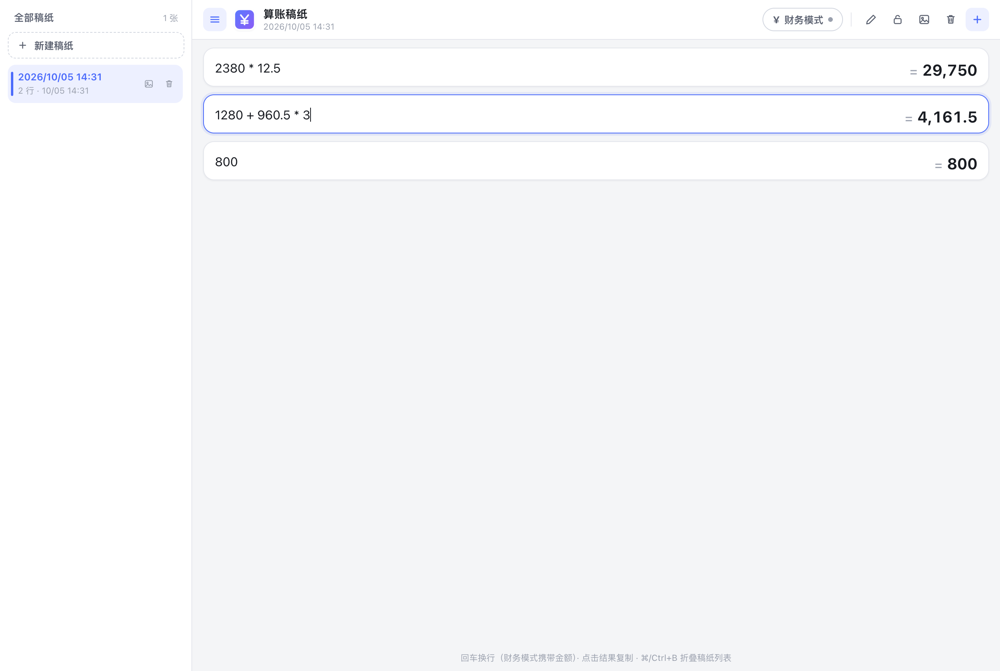
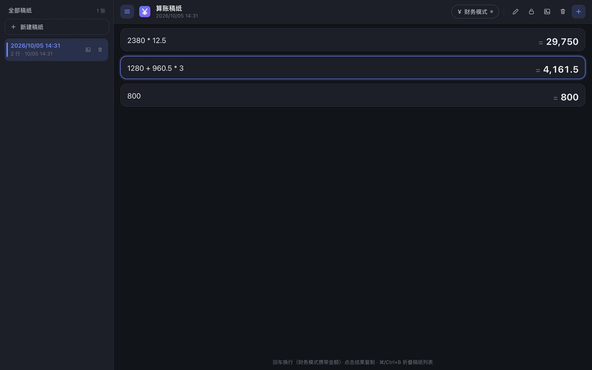
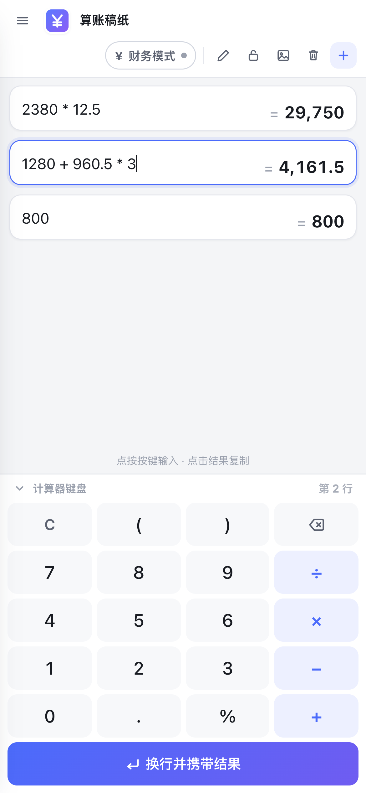
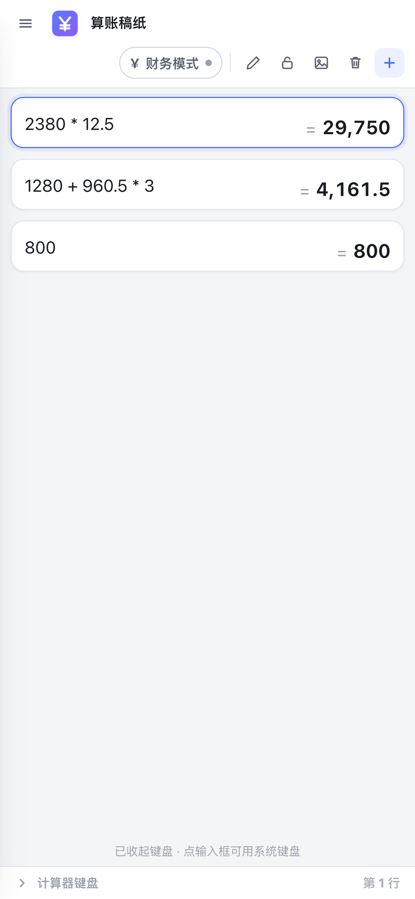

# 算账稿纸 · PWA

像稿纸一样逐行计算，实时求值、自动保存；财务模式金额四舍五入到分，一键复制人民币大写。
**纯静态页面，零第三方依赖，完全离线可用，可安装到桌面/主屏。**

从 uTools 插件「算账稿纸」移植而来，引擎与交互逻辑完全一致。

## 界面预览

| 桌面端 | 深色模式 |
| --- | --- |
|  |  |

| 移动端（键盘展开） | 移动端（键盘收起） |
| --- | --- |
|  |  |

> 截图由 `npm run test:browser` 自动生成，始终与当前代码保持一致。

---

## 快速开始

### 直接打开（最简单）

双击 `index.html` 即可使用。所有计算、财务模式、复制、自动保存都正常工作。

> `file://` 协议下浏览器不允许注册 Service Worker，因此**无法安装为 PWA**，
> 但这不影响任何核心功能（页面会静默跳过注册，无报错）。

### 本地预览（含 PWA）

```bash
npm run serve          # 默认 http://localhost:8185，同时监听 0.0.0.0（局域网可访问）
```

Service Worker 需要 `http://localhost` 或 `https://` 环境。用 localhost 打开后，
即可在浏览器地址栏看到「安装」按钮。

> **用手机测试**：启动后终端会打印局域网地址（如 `http://192.168.1.5:8185/`）。
> 注意局域网 http 属于非安全上下文，浏览器不会注册 Service Worker（因此不能安装 PWA），
> 但计算、财务模式、复制等核心功能都可正常使用。

### 部署到线上

把整个仓库目录（除 `tools/`、`tests/` 外都是运行时文件）上传到任意静态托管即可：

- **GitHub Pages**：仓库 Settings → Pages → 选择分支与目录。支持子目录路径（已在 `tests/browser.test.mjs` 中覆盖验证）
- **Vercel / Netlify / Cloudflare Pages**：直接连接仓库，无需构建命令，输出目录填 `.`
- **对象存储（OSS / COS / S3）**：上传文件并开启静态网站托管

> 部署后请确保使用 **HTTPS**：Service Worker 与剪贴板 API 都要求安全上下文。

---

## 功能

| 功能 | 说明 |
| --- | --- |
| 逐行实时计算 | 每行输入表达式立即出结果，支持 `+ - * / ^ % ( )`、`sqrt/abs/round/floor/ceil/min/max`、常量 `pi`/`e` |
| 高精度运算 | 自研十进制引擎（BigInt），加减乘完全精确；`1.005` 正确四舍五入为 `1.01`，无浮点误差 |
| 财务模式 | 每行同时显示原值与金额（四舍五入到分），点金额复制数字、点「大写」复制人民币大写 |
| 回车连算 | 回车进入下一行并携带上一行结果；财务模式下携带的是四舍五入后的金额 |
| 计算器键盘 | 移动端底部自带可收起的数字键盘（含 `+ − × ÷ % ( )` 与退格），点按即在光标处插入 |
| 多稿纸管理 | 左侧稿纸列表（桌面常驻可折叠 / 移动端抽屉），新建、双击重命名、锁定、导出图片、两步确认删除 |
| 自动保存 | 输入后自动保存到本地，刷新或重开都不丢 |
| 明暗主题 | 跟随系统 `prefers-color-scheme` |
| 完全离线 | Service Worker 预缓存应用外壳，断网也能打开 |
| 可安装 | 支持安装到桌面（macOS/Windows/Linux）与手机主屏（iOS/Android） |

### 移动端计算器键盘

窄屏（≤720px）下页面底部会出现自绘键盘，点标题栏「计算器键盘」即可收起/展开，状态会被记住。

- **点按即插入**：按键插入到光标位置（替换选中内容），而不是只能追加到末尾
- **作用行明确**：标题栏右侧显示当前行号（如「第 2 行」），点任意输入行即可切换
- **不弹系统键盘**：键盘展开时输入框设为 `inputmode="none"`，避免自绘键盘与系统键盘叠加；收起后自动恢复系统键盘
- **换行键携带结果**：与物理回车一致，财务模式下携带四舍五入后的金额
- 空行按退格会删除该行，与物理键盘行为一致

### 输入小技巧

- 全角字符自动转换：`（１２３＋４５６）` 等价于 `(123+456)`
- `x` 可当乘号：`2x3`、`2 x 3` 都能算
- 千分位逗号自动忽略：`1,234.56 + 1` 结果为 `1,235.56`

---

## 项目结构

```
.
├── index.html              页面骨架（含 PWA meta）
├── styles.css              样式（明暗双主题 + 响应式）
├── core.js                 计算引擎（无 DOM 依赖，可单独在 Node 中测试）
├── app.js                  界面逻辑与状态管理
├── pwa.js                  Service Worker 注册与快捷方式处理
├── sw.js                   Service Worker（预缓存 + 离线回落）
├── manifest.webmanifest    PWA 清单
├── icons/                  图标（含 maskable 与 iOS 版本）
├── tools/
│   ├── serve.mjs           零依赖本地静态服务器
│   └── gen-icons.mjs       从 logo.png 生成全套 PWA 图标
└── tests/
    ├── core.test.js        引擎单元测试（75 项）
    └── browser.test.mjs    浏览器端回归测试（40 项，CDP 驱动）
```

---

## 开发

```bash
npm test              # 引擎单元测试
npm run icons         # 重新生成图标（改了 icons/logo.png 后执行）

# 浏览器回归测试：需要先启动服务与可调试浏览器
npm run serve &
"/Applications/Microsoft Edge.app/Contents/MacOS/Microsoft Edge" \
  --headless=new --remote-debugging-port=9223 --no-first-run about:blank &
node tests/browser.test.mjs http://localhost:8185/
```

浏览器测试覆盖：计算正确性、财务模式、复制、回车携带、持久化、移动端布局无横向溢出、
断点切换（桌面折叠偏好与移动抽屉状态互不污染）、PWA 清单与图标、Service Worker 注册与**离线可用**。

截图产物：`tests/screenshot-{desktop,mobile,dark}.png`

### 图标

`icons/logo.png` 是唯一图标源文件（512×512）。`tools/gen-icons.mjs` 会生成：

- `icon-192/512.png` — 保留原始圆角造型，`purpose: any`
- `icon-maskable-192/512.png` — 满幅出血（圆角外的透明区用底色沿半径向内取样填充），`purpose: maskable`，保证在 Android 自适应图标下不被裁切
- `apple-touch-icon.png` — iOS 主屏（不透明）
- `favicon-32/16.png` — 标签页

脚本内含自检（四角不透明、无透明像素、字形落在安全区内），失败时以非零码退出。

---

## 与 uTools 版本的关系

`app.js` 保留了 `IS_UTOOLS` 分支：同一份代码在 uTools 中运行时使用 `ut.db` 与 `ut.copyImage`，
在普通浏览器中则降级为 `localStorage` + Clipboard API。因此两个版本可以共用逻辑、独立演进。

浏览器端的差异处理：

- **复制文本**：优先 Clipboard API；非安全上下文（`file://`、局域网 http）回退 `execCommand`
- **导出图片**：优先写入剪贴板；Safari/Firefox 等未实现 `ClipboardItem` 的浏览器自动改为下载 PNG
- **布局**：≤720px 时侧栏变为抽屉（带遮罩），顶栏工具栏允许换行，避免横向溢出

## 浏览器要求

需要支持 `BigInt` 与 `async/await` 的现代浏览器（Chrome/Edge 67+、Safari 14+、Firefox 68+）。
正则表达式不使用 lookbehind，以兼容 Safari 16.4 以下版本。

## 许可证

MIT
